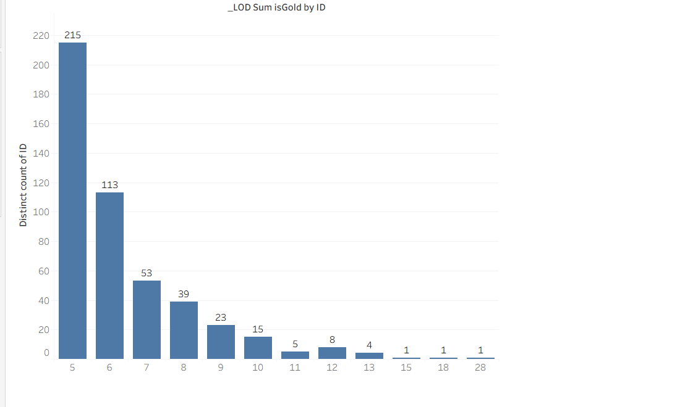
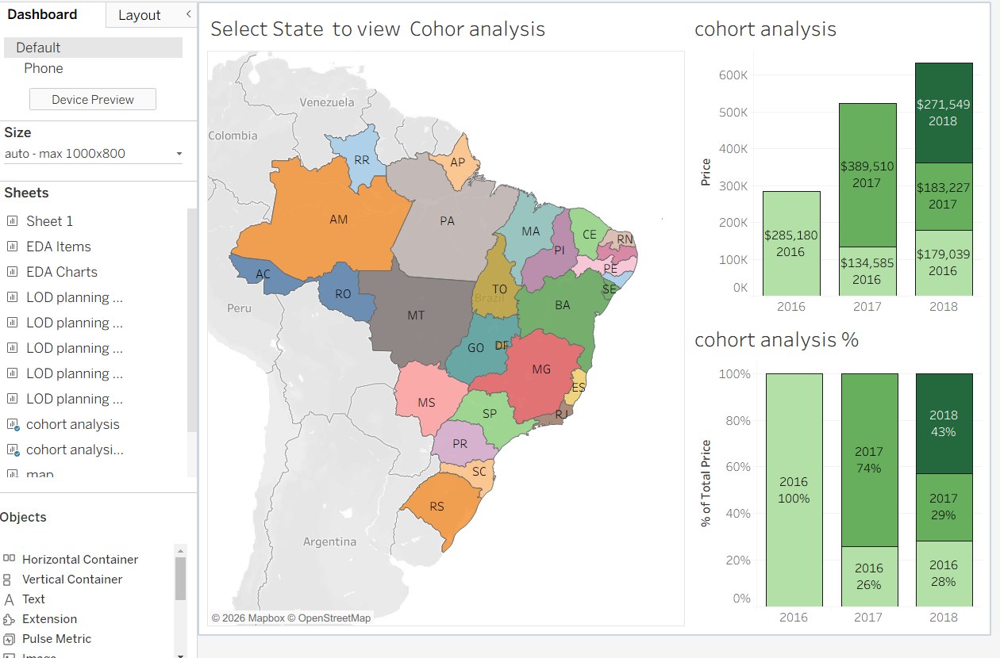
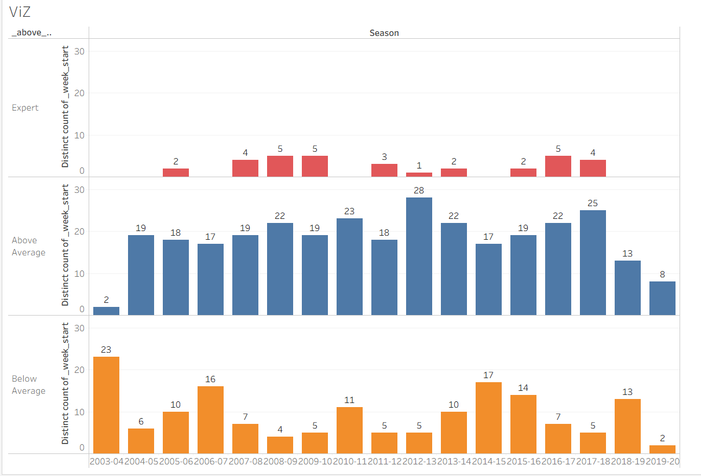
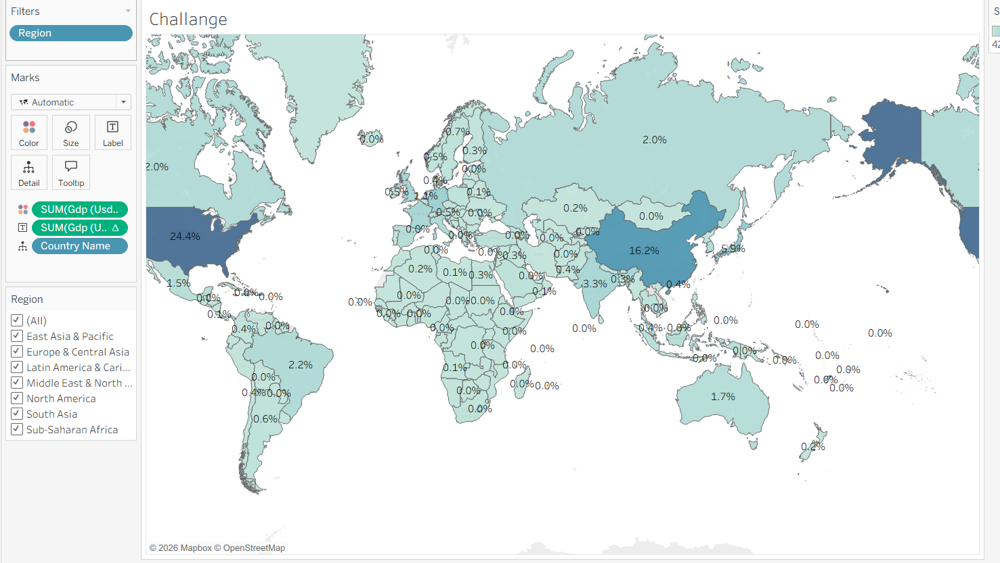
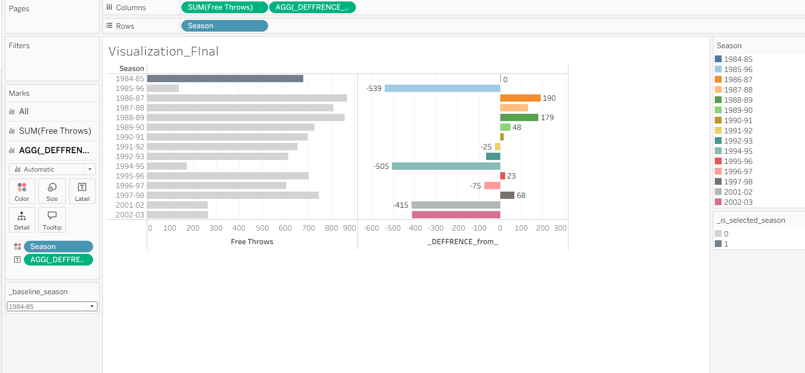
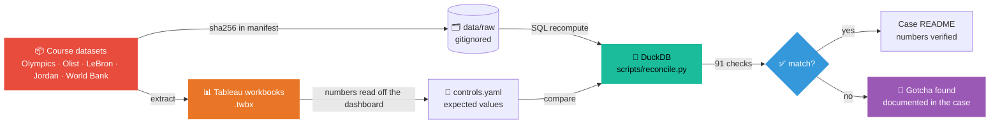

# 📐 Tableau LOD Cases — Verified Against SQL

Five Tableau case studies on **Level of Detail (LOD) expressions**, where every number on every dashboard is **recomputed in SQL (DuckDB) and compared automatically**. Not "I built a chart" but "the chart is provably right, and here is where Tableau quietly misleads you".

<p align="center">
  
  
  
  
  
  <a href=".github/workflows/ci.yml"></a>
</p>

> *"Tableau dashboards tested against SQL: 5 cases, 91 numeric checks, 8 gotchas the dashboards would never have told me about."*

---

## The 5 cases

| # | Case | Technique | Headline number | Live |
|---|---|---|---|---|
| 01 | [Olympic medals frequency](cases/01-olympics-medal-frequency) | `FIXED` LOD per athlete → histogram | 215 athletes with exactly 5 medals | [Tableau Public](https://public.tableau.com/app/profile/evgenii.matveev/viz/LODPlanning_17929971484250/Sheet7) |
| 02 | [Olist returning customers](cases/02-olist-cohort) | `FIXED` LOD cohort (`MIN` order date) | $1,443,090 total across 6 cohort cells | [Tableau Public](https://public.tableau.com/app/profile/evgenii.matveev/viz/LOD_cohoranalysishmdashboard/Dashboard1) |
| 03 | [LeBron weekly KPI](cases/03-lebron-weekly-kpi) | `FIXED` LOD + parameters | 504 weeks bucketed, 10 with no data | [Tableau Public](https://public.tableau.com/app/profile/evgenii.matveev/viz/WeeklyPerformanceKPI/TheChallenge) |
| 04 | [World GDP share](cases/04-worldbank-pct-total) | `FIXED` LOD percent of total, region LOD | $83.9T world GDP (2018), China 16.2% | [Tableau Public](https://public.tableau.com/app/profile/evgenii.matveev/viz/LOD_Percent_of_Total/VIZ) |
| 05 | [Jordan free throws vs baseline](cases/05-jordan-exclude-lod) | `EXCLUDE` LOD + parameter | 15 seasons, 1984-85 baseline = 678 free throws | [Tableau Public](https://public.tableau.com/app/profile/evgenii.matveev/viz/LOD_Comparative_Performance_Analysis/Visualization_FInal) |

<details>
<summary>📸 Screenshots</summary>

| Olympics: medals per athlete | Olist: cohort dashboard |
|---|---|
|  |  |

| LeBron: weeks per category per season | World GDP: global share |
|---|---|
|  |  |

| Jordan: free throws vs baseline season |
|---|
|  |

</details>

---

## What makes it different: the SQL check



Each Tableau result becomes a control value; the same metric is recomputed in plain SQL from the raw files; the script exits non-zero if they diverge. Disagreements are where the interesting bugs live.

---

## 🐞 Gotchas the SQL check exposed

| Case | What Tableau showed | What was really going on |
|---|---|---|
| 02 Olist | Cohort sales 389,510 / 271,549 | A first SQL version with an `INNER JOIN` gave 390,300 / 272,147. The cohort date is the `MIN` over **all** orders, including canceled ones with no items, so the join must be `LEFT`. |
| 03 LeBron | 160 weeks "Below Average" | 10 of them have **no Game Score at all**: `AVG` is NULL, no comparison is true, `ELSE` swallows them. The honest split is 150 + 10 "No data". |
| 03 LeBron | Same weeks, different SQL counts | Tableau weeks start on **Sunday**, DuckDB's `date_trunc('week')` on Monday. SQL needs `date_trunc('week', d + 1) - 1`. |
| 04 World GDP | China 53.9% on the filtered map | That is a table calc (share of the *filtered view*). The FIXED LOD says 16.2% (share of the *world*). Same field, two denominators. |
| 04 World GDP | 28 countries show "Null", not 0% | `SUM` ignores NULL GDP: those countries are missing from the total, not zero. Without the Year filter the total would be 1.63 quadrillion. |
| 01 Olympics | `CNT(Name)` = 30 for Phelps | Counts **rows**, not medals (28). Group by `ID`, never `Name`; and `"NA"` is a text string in the CSV, not NULL. |
| 05 Jordan | Season 1984-85 = 678 free throws | Playoffs are inside every season total (4 of that season's games). 3 of 1,254 rows are `Did Not Dress` rows with NULL free throws: `SUM` ignores them, a row count would not. |
| 05 Jordan | Season "1985-96" on the axis | A typo in the source for 1985-86; it only works because it is the same in every row. Seasons 1993-94 and 1998-2001 are missing, not zero. |

---

## Run it

```bash
git clone https://github.com/evgeniimatveev/tableau-business-cases
cd tableau-business-cases
# put the datasets into data/raw/ (see "Get the data" below)
uv run scripts/reconcile.py        # prints OK/FAIL per check, exit code 1 on any mismatch
```

`reconcile.py` is a self-contained [uv script](https://docs.astral.sh/uv/guides/scripts/) (DuckDB + PyYAML declared inline), so there is no environment to set up.

### Get the data

The raw files are **not in the repo** (size and unclear licenses); `data/raw/` is gitignored. All five came from the SuperDataScience course *Tableau Business Cases: LOD Expressions* and are course subsets, so they may differ from the public originals. The checksums in [`data/manifest.yaml`](data/manifest.yaml) are of the course versions.

| Case | Files for `data/raw/` | Where to get them |
|---|---|---|
| 01 Olympics | `athlete_events.csv`, `noc_regions.csv` | Kaggle: [120 years of Olympic history](https://www.kaggle.com/datasets/heesoo37/120-years-of-olympic-history-athletes-and-results) (download the zip, unpack both files) |
| 02 Olist | `olist_orders_dataset.csv`, `olist_customers_dataset.csv`, `olist_order_items_dataset.csv` | Kaggle: [Brazilian E-Commerce by Olist](https://www.kaggle.com/datasets/olistbr/brazilian-ecommerce) (3 of the 9 files) |
| 03 LeBron | `LeBron James Career.csv` | Course material only, no public source. The Tableau Public viz has the data embedded |
| 04 World GDP | `WorldBank Data.xlsx` | [World Bank Open Data](https://data.worldbank.org/) indicators, 211 countries x 1960-2018 (the course extract; a fresh download will differ) |
| 05 Jordan | `Michael Jordan Career.csv` | Course material only, no public source. The Tableau Public viz has the data embedded |

Then check each file against the manifest (first 16 hex chars of sha256): `python -c "import hashlib,sys;print(hashlib.sha256(open(sys.argv[1],'rb').read()).hexdigest()[:16])" "data/raw/<file>"`.

`reconcile.py` runs only the cases whose files are present and prints `SKIP case NN` for the rest, so you can reproduce any subset. If a public download differs from the course file, the numbers can legitimately differ too: that is what the checksum is for.

### Two layers of checks

| Layer | Where it runs | What it proves |
|---|---|---|
| **91 reconcile checks** on the real data | locally (`uv run scripts/reconcile.py`) | every number on the dashboards is reproduced in SQL |
| **SQL logic tests** on tiny hand-computed fixtures + repo checks | **GitHub Actions on every push** (badge above) | the SQL itself is right: each test guards one gotcha |

CI cannot download the Kaggle and course files, so it does not pretend to: it runs `pytest` on fixtures of 5 to 6 rows (Sunday weeks, `LEFT JOIN` cohorts, NULL weeks, ID vs Name, one-year filter) plus a hygiene check (manifest complete, controls present, README links resolve). The tests were mutation-checked: switching the SQL to Monday weeks, an `INNER JOIN` or grouping by name each makes a test fail.

```bash
uv run --with pytest --with duckdb --with pyyaml pytest -v   # the logic tests
uv run scripts/check_repo.py                                  # manifest / controls / links
```

---

## Repo structure

```
.
├── README.md
├── controls.yaml                 # expected values read off the Tableau dashboards
├── scripts/
│   ├── queries.py                # the SQL of every case, as functions over table expressions
│   ├── reconcile.py              # runs queries.py on the real data and compares to controls.yaml
│   └── check_repo.py             # manifest / controls / README link checks
├── tests/
│   ├── test_queries.py           # one test per gotcha, on tiny fixtures
│   └── fixtures/                 # hand-computed CSVs (5 to 6 rows each)
├── .github/workflows/ci.yml      # pytest + repo checks, results in the Job Summary
├── data/
│   └── manifest.yaml             # sources, licenses, sha256 (raw files are gitignored)
└── cases/
    ├── 01-olympics-medal-frequency/   README · workbook.twbx · img/
    ├── 02-olist-cohort/               README · workbook.twbx · img/
    ├── 03-lebron-weekly-kpi/          README · workbook.twbx · img/
    ├── 04-worldbank-pct-total/        README · workbook.twbx · img/
    └── 05-jordan-exclude-lod/         README · workbook.twbx · img/
```

## Tech stack

| Layer | Tool |
|---|---|
| BI | Tableau (LOD `FIXED`, parameters, table calcs, dashboards) |
| Verification | DuckDB SQL (window functions, `strptime`, `read_xlsx`) |
| Runner | Python + `uv` (inline script dependencies) |
| Data provenance | `manifest.yaml` with sha256 per file |

---

## Data and attribution

- Olist: [Brazilian E-Commerce Public Dataset by Olist](https://www.kaggle.com/datasets/olistbr/brazilian-ecommerce), CC BY-NC-SA 4.0 (non-commercial, share-alike).
- Olympics: [120 years of Olympic history](https://www.kaggle.com/datasets/heesoo37/120-years-of-olympic-history-athletes-and-results) (Kaggle, scraped from sports-reference.com).
- World Bank indicators: [data.worldbank.org](https://data.worldbank.org/), CC BY 4.0 by default.
- Michael Jordan career stats: course material; the raw CSV is not redistributed, the case 05 workbook `.twbx` embeds it.
- LeBron James career stats: course material, published here only as the case 03 workbook (`.twbx`) and the [Tableau Public viz](https://public.tableau.com/app/profile/evgenii.matveev/viz/WeeklyPerformanceKPI/TheChallenge); the raw CSV is not redistributed.

Practice built on the SuperDataScience course *Tableau Business Cases: LOD Expressions*.

---

*Built with Claude Code · Built by [Evgenii Matveev](https://github.com/evgeniimatveev)*
