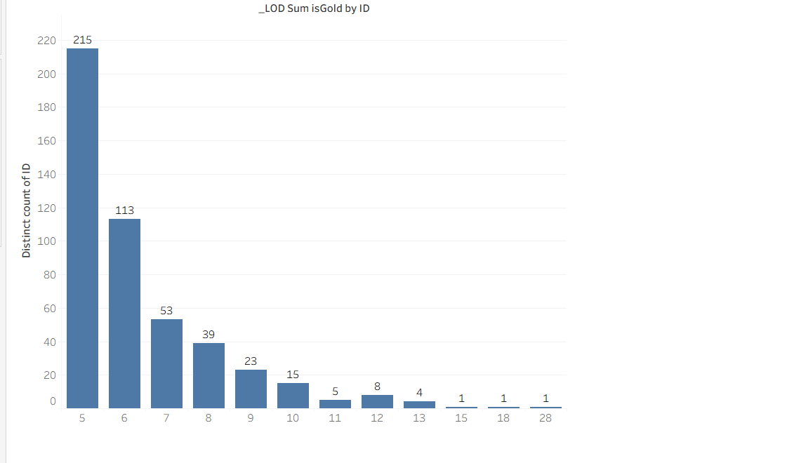

# 01 · Olympic medals frequency (FIXED LOD)

**Question:** how many athletes won 1, 2, 3 ... medals? (a frequency histogram of a per-athlete aggregate)

**Data:** `athlete_events.csv` (271,116 rows, 1896-2016) and `noc_regions.csv`. See [`data/manifest.yaml`](../../data/manifest.yaml).



## Why LOD
The chart needs *athletes* on the Y axis and *medals per athlete* on the X axis. Medals per athlete is an aggregate that has to become a dimension, and a FIXED LOD does exactly that.

```
_isMedal:               IIF([Medal]="NA", 0, 1)
_LOD Sum isGold by ID:  {FIXED [ID] : SUM([_isMedal])}      -- used as a dimension, measure = COUNTD([ID])
```
Screens: [`_isMedal`](img/formula-isMedal.png), [LOD by ID](img/formula-lod-sum-by-id.png), [`_isGold`](img/formula-isGold.png), [LOD by NOC](img/formula-lod-sum-by-noc.png), [challenge: medals per name](img/viz-challenge-medals-by-athlete.png).

## Gotchas found
- `"NA"` is a **text string** in the CSV, not NULL. `IIF(...,"NA",...)` works, a NULL check would not.
- Group by **`ID`, not `Name`**: names collide. `CNT(Name)` counts *rows* (30 for Phelps, who has 28 medals), `COUNTD(ID)` counts athletes.
- Misleading field name: `_LOD Sum isGold by ID` actually sums `_isMedal` (all medals). Only the NOC variant uses `_isGold`.
- Chart type: bars on a **continuous** axis. A line or area chart would interpolate over the gaps (13 to 28 medals) and mislead.

## Reconciled in SQL (`scripts/reconcile.py`)
| Check | Tableau | DuckDB |
|---|---|---|
| rows | 271,116 | 271,116 |
| athletes with 5 medals | 215 | 215 |
| athletes with 6 medals | 113 | 113 |
| athletes with 7+ medals | 150 | 150 |

Top athletes by medals: Phelps 28, Latynina 18, Andrianov 15.
