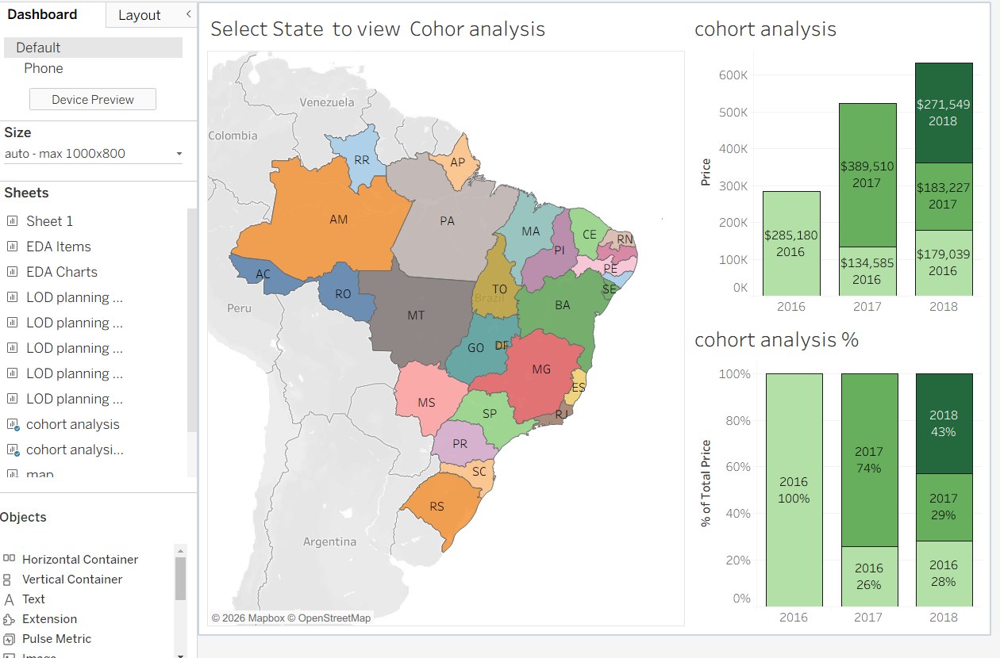

# 02 · Returning customers: cohort analysis (FIXED LOD)

**Question:** how much of each year's sales comes from customers acquired in earlier years?

**Data:** three Olist tables (orders, order items, customers), 2016-2018. See [`data/manifest.yaml`](../../data/manifest.yaml).



## The LOD
```
Cohort date = { FIXED [Customer Unique Id] : MIN([Order Purchase Timestamp]) }
```
Every order row gets the date of that customer's *first* order, and the year of that date is the cohort. Planning view: [`lod-planning-table`](img/lod-planning-table.png), formula: [`formula-lod-min-order-date`](img/formula-lod-min-order-date.png).

## Result (sales = sum of price)
| Cohort \ Order year | 2016 | 2017 | 2018 |
|---|---|---|---|
| 2016 | 285,180 | 134,585 | 179,039 |
| 2017 |  | 389,510 | 183,227 |
| 2018 |  |  | 271,549 |

Total 1,443,090. The dashboard (map filter by state, cohort, cohort %) is the view to publish.

## Gotchas found
- **INNER vs LEFT JOIN changes the answer.** A first SQL attempt joined order items with an INNER join and gave 390,300 / 272,147 instead of 389,510 / 271,549. The cohort date must be the MIN over **all** orders, including canceled or unavailable ones that have no items, because the LOD in Tableau sees the orders table. Fix: LEFT JOIN items.
- Dates arrive as `dd/m/yy h:mm`. DuckDB auto-detect misreads them as `yy-mm-dd` (years 0010-0018), so parse with `strptime(col, '%d/%m/%y %H:%M')`.

## Reconciled in SQL
All 6 matrix cells and the total match Tableau to the dollar (`uv run scripts/reconcile.py`).
