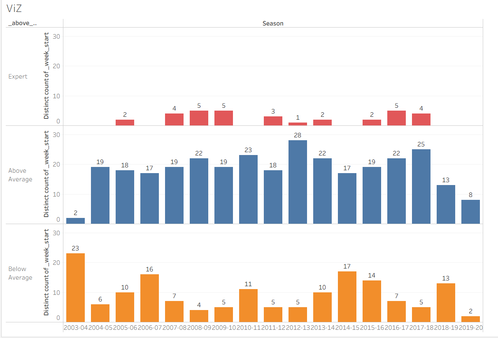

# 03 · Weekly performance KPI: LeBron James career (FIXED LOD + parameters)

**Question:** in how many weeks per season was the weekly average Game Score "Expert", "Above Average" or "Below Average"?

**Data:** `LeBron James Career.csv` (1,566 games, 2003-2020, 99 of them without a Game Score). See [`data/manifest.yaml`](../../data/manifest.yaml).



**[Live on Tableau Public](https://public.tableau.com/app/profile/evgenii.matveev/viz/WeeklyPerformanceKPI/TheChallenge)**

## Formulas
```
_week_start:                  DATETRUNC('week', [Date])
_LOD_AVG_GAMESCORE_BY_WEEK:   { FIXED DATETRUNC('week',[Date]) : AVG([Game Score]) }
_above_or_below:
  IF [_LOD_AVG_GAMESCORE_BY_WEEK] > [_game_score Expert] THEN 'Expert'
  ELSEIF [_LOD_AVG_GAMESCORE_BY_WEEK] > [_game_score AVG] THEN 'Above Average'
  ELSE 'Below Average' END
```
Two Float parameters (range 5-40, step 1) replace the hard-coded cutoffs: [`_game_score AVG`](img/param-game-score-avg.png) = 20 and [`_game_score Expert`](img/param-game-score-expert.png) = 30. Other screens: [planning table](img/lod-planning-table.png), [challenge chart](img/viz-challenge-game-score-by-season.png). The reference line 22.45 on the challenge chart is the career mean Game Score, which is where the first version's cutoff of 22 came from.

## Result (cutoffs 20 / 30): 504 weeks
Expert 33 · Above Average 311 · Below Average 160. Per-season counts are in `controls.yaml`.

## Gotchas found
- **Weeks with no data look like "Below Average".** 10 of the 504 weeks have no Game Score at all. `AVG` is NULL, no comparison is true, so `ELSE` labels them 'Below Average'. They sit inside the 160, and a NULL guard would give 150 plus 10 "No data".
- **Week start differs:** Tableau weeks start on Sunday by default, DuckDB's `date_trunc('week')` on Monday. SQL needs `date_trunc('week', d + 1) - 1`.
- The label belongs to the **week**, not the game: every game in a week gets the same category.
- The parameters feed only the bucketing, not the LOD: the weekly average never changes, only the cutoffs.
- Nothing stops `Expert < AVG` (both ranges are 5-40). Then 'Above Average' can never appear.
- Boundaries are strict: exactly 30 is not Expert.

## Reconciled in SQL
All 17 seasons x 3 categories, the 504 weeks, the 10 empty weeks, the 99 NULL scores and the mean 22.45 match Tableau.
