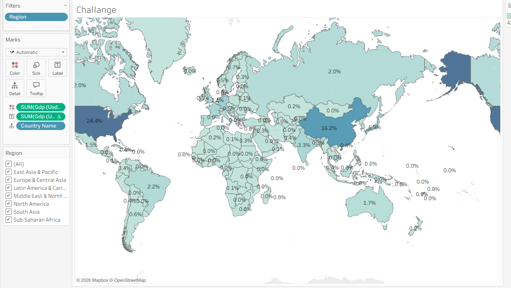

# 04 · Percent of total GDP: World Bank (FIXED LOD)

**Question:** what share of world GDP does each country hold, and what share of its region?

**Data:** `WorldBank Data.xlsx` (211 countries x 1960-2018, 7 regions). The numbers here are for **2018**. See [`data/manifest.yaml`](../../data/manifest.yaml).



## Formulas
```
_Sum gdp by all:   { FIXED : SUM([Gdp (Usd)]) }                  -- world total, 83,874,523,992,955
_% global by gdp:  [Gdp (Usd)] / [_Sum gdp by all]
_Lod for Region:   { FIXED [Region] : SUM([Gdp (Usd)]) }          -- region total
```
Screens: [`_Sum gdp by all`](img/formula-sum-gdp-by-all.png), [`_% global by gdp`](img/formula-pct-global-by-gdp.png), [`_Lod for Region`](img/formula-lod-for-region.png), [planning table](img/lod-planning-table.png), [map filtered to East Asia & Pacific](img/viz-region-filter-east-asia-pacific.png).

## The point of the case: LOD vs table calculation
Two different denominators side by side. With Region = East Asia & Pacific on the map, China shows **53.9%** (table calc: share of the filtered view) while the LOD share stays **16.2%** (share of the world). The FIXED total ignores dimension filters, while a table calc depends on what is in the view.

| Country | LOD global share | Region share (`_Lod for Region`) |
|---|---|---|
| China | 16.21% | 53.883228% of East Asia & Pacific (25.24T) |
| Japan | 5.93% | 19.69% |
| USA | 24.44% | 92.30% of North America |

## Gotchas found
- The file holds **59 years**. The world total 83.87T equals 2018 alone, so the workbook restricts Year to the range 2018-2018 (a quantitative filter on `[Year]`, visible in the workbook XML) (all years summed would be 1.63 quadrillion). There are no aggregate rows such as "World", so nothing double-counts.
- **28 countries have NULL GDP in 2018** (North Korea, New Caledonia, Guam ...). `SUM` ignores them, their share is Null (not 0%) and they are missing from the total.
- Tiny shares print as 0.0%, so use more decimals or a top-N.
- `{ FIXED : ... }` with no dimension ignores every dimension filter unless the filter is added to context.

## Reconciled in SQL
World total, France 3.31%, China and USA global share, China and Japan region share, 211 countries, 7 regions and 28 NULL-GDP countries all match.
