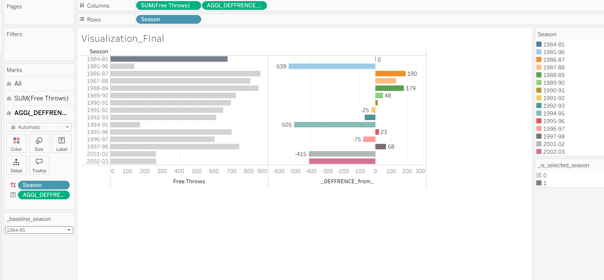

# 05 · Free throws vs a baseline season: Michael Jordan (EXCLUDE LOD + parameter)

**Question:** how many more (or fewer) free throws did Jordan make in each season than in a season I pick?

**Data:** `Michael Jordan Career.csv` (1,254 rows, 15 seasons 1984-2003, regular season + playoffs together). See [`data/manifest.yaml`](../../data/manifest.yaml).



**[Live on Tableau Public](https://public.tableau.com/app/profile/evgenii.matveev/viz/LOD_Comparative_Performance_Analysis/Visualization_FInal)** (pick any of the 15 seasons in the dropdown and every bar moves)

## Formulas
```
_baseline_season:         String parameter, list of the 15 seasons
_FT Selected_season:      IIF([Season] = [_baseline_season], [Free Throws], 0)
LOD_SUM_FT_SELECTED:      { EXCLUDE [Season] : SUM([_FT Selected_season]) }
_DEFFRENCE_from_:         SUM([Free Throws]) - SUM([LOD_SUM_FT_SELECTED])
_is_selected_season:      IIF([Season] = [_baseline_season], 1, 0)      (colors the baseline bar)
```
Screens: [parameter](img/param-baseline-season.png), [`_FT Selected_season`](img/formula-ft-selected-season.png), [LOD](img/formula-lod-sum-ft-selected.png), [difference](img/formula-difference.png), [`_is_selected_season`](img/formula-is-selected-season.png), [planning table](img/lod-planning-table.png), [career progression](img/viz-career-progression.png).

## How it works
The row-level `IIF` turns every row of the baseline season into its free throws and every other row into 0. `EXCLUDE [Season]` then sums that column **ignoring Season in the view**, so each season row sees the same number: the baseline total (678 for 1984-85). The difference is just the bar minus that constant, and the baseline season is always 0.

## Result (baseline 1984-85 = 678 free throws)
Most seasons sit within +-200 of the baseline: 1986-87 is +190, 1988-89 +179, 1997-98 +68. The lows are 1985-96 (-539) and 1994-95 (-505), the two seasons he barely played. The comeback seasons 2001-02 and 2002-03 are -415 and -412. All 15 seasons are in `controls.yaml`.

## Gotchas found
- **Playoffs are inside every season.** The baseline 678 is 4 playoff games plus 82 regular-season games. Over the whole file playoffs are 1,463 of 8,790 free throws, so a regular-season-only baseline would shift every bar.
- **"1985-96" is a typo in the source** (it is the 1985-86 season, his foot-injury year: 18 regular-season games). It is the right label for Tableau only because the same typo is in every row.
- **Seasons that never happened are not zero, they are missing:** no 1993-94 (baseball), none for 1998-2001 (retirement). The chart has 15 bars, not 19, and any "per year" reading has gaps.
- **3 of the 1,254 rows are not games** (`Did Not Dress`, `Not With Team`, `Inactive`, all 2001-02): Free Throws is NULL. `SUM` ignores them, but `COUNT` of rows would count 1,254 games instead of 1,251.
- `EXCLUDE` here is equivalent to `FIXED` with no dimensions, but it keeps following the view: add another dimension and the baseline is recomputed per it, a `FIXED` would not.
- **The baseline is a dropdown, not a fixed number.** `_baseline_season` lists all 15 seasons; the numbers above are the state for 1984-85 (read off Tableau), and the saved `.twbx` opens on whichever season was last selected. The SQL check also runs all 15 choices: for each, the baseline bar is 0 and every other bar is its free throws minus the baseline's.

## Reconciled in SQL
All 15 season totals, all 15 differences, the toggle on all 15 baselines, the 1,254 rows, the 3 NULL rows and the 1,463 playoff free throws match Tableau.
